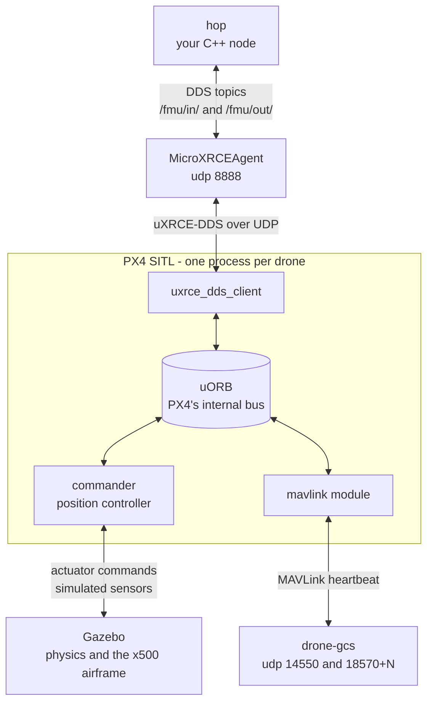

# How it works, and how to grow it into a swarm

Start here if you want to write flight code. Getting the stack running is
[SETUP.md](SETUP.md) for the dev container and [NATIVE-SETUP.md](NATIVE-SETUP.md)
for a native install, and [QUICKSTART.md](../QUICKSTART.md) is the command
reference. This is the one that explains *why* any of it is shaped the way it
is.

The worked example is [`src/drone_swarm/src/hop.cpp`](../src/drone_swarm/src/hop.cpp):
one drone, takes off, flies three metres forward, lands. It is one file and it
is heavily commented, so read it alongside this. Everything a swarm needs is
already in there except the swarm.

## Run it

Four terminals. The first three are the simulator and never change; only the
fourth is your code. The commands are the same in the dev container and on a
native install.

```bash
MicroXRCEAgent udp4 -p 8888     # 1. the bridge between PX4 and ROS 2
drone-gcs                       # 2. the ground station link PX4 requires
drone-sim                       # 3. PX4 + Gazebo, gives you a pxh> prompt
ros2 run drone_swarm hop        # 4. your flight program
```

Watch it in Gazebo, which is at <http://localhost:6080> in the dev container and
a window on your desktop natively. Expect this:

```
[INFO] [hop]: will climb to 3.0 m, fly 3.0 m north, and land. Commanding /fmu/.
[INFO] [hop]: armed.
[INFO] [hop]: offboard engaged, climbing to 3.0 m.
[INFO] [hop]: at altitude, flying 3.0 m forward.
[INFO] [hop]: arrived, landing.
[INFO] [hop]: landed and disarmed. Flight complete.
```

Change the flight without touching the code:

```bash
ros2 run drone_swarm hop --ros-args -p altitude_m:=6.0 -p forward_m:=10.0
```

## The pipeline

Your node never touches a motor. It hands PX4 a position ten times a second,
and PX4 flies there. Every hop between your `for` loop and a spinning
rotor:



Walking it from the top:

**Your node** publishes `TrajectorySetpoint` ("be at north 3, east 0, down -3")
and `OffboardControlMode` ("act on the position field"), and subscribes to
`VehicleLocalPosition` and `VehicleStatus` to find out what actually happened.
These are ordinary ROS 2 topics.

**MicroXRCEAgent** is a translator. ROS 2 speaks DDS; PX4 speaks a compact
variant called uXRCE-DDS designed for microcontrollers. The agent sits between
them. It has to be running before PX4 starts, or PX4's client gives up looking
for it and no `/fmu/` topics ever appear.

**uxrce_dds_client** runs inside PX4 and is what actually creates the `/fmu/`
topics. It is the reason topic names are `/fmu/in/...` and `/fmu/out/...` and
why you cannot rename them from the ROS side.

**uORB** is PX4's internal publish/subscribe bus. Every PX4 module talks over
it. The client is just a bridge from uORB onto the network, which is why
`px4_msgs` message definitions are byte-for-byte PX4's own: there is no
translation layer to get wrong.

**commander and the position controller** are the flight stack. Commander owns
arming, flight modes and failsafes; the position controller turns your setpoint
into attitude and thrust. This is the part that is identical between SITL and a
real Pixhawk, and it is why a bug in your node sends the drone to the wrong
place rather than making it fall out of the sky.

**Gazebo** provides physics and sensors. PX4 and Gazebo run in lockstep, so a
slow laptop takes longer in wall-clock seconds without changing the flight.
Details in [SIMULATION-FIDELITY.md](SIMULATION-FIDELITY.md). It is also the only
box in that diagram which does not exist on a real aircraft;
[UNDER-THE-SCRIPTS.md](UNDER-THE-SCRIPTS.md) maps the rest onto the hardware.

**mavlink and drone-gcs** are a separate conversation entirely, carrying no
commands from you. PX4's x500 airframe sets `NAV_DLL_ACT 2`, "return home on
datalink loss", and PX4 refuses to take off with a failsafe whose precondition
is already broken. `drone-gcs` supplies the heartbeat that satisfies it, the
same role QGroundControl plays. It is a dial tone, not an authority. Killing it
mid-flight is a legitimate test: you get to watch the failsafe fire.

## The three rules

Nearly every "my offboard node does nothing" is one of these. Each is marked
`RULE 1/2/3` in `hop.cpp` at the line that obeys it.

### Rule 1: QoS has to match

PX4 publishes `/fmu/out/` as **BEST_EFFORT** with **TRANSIENT_LOCAL**
durability. A default ROS 2 subscriber is **RELIABLE** and **VOLATILE**. Those
are incompatible, so your subscription is created without an error, never
matches the publisher, and your callback never fires. Nothing is logged.

`ros2 topic echo` negotiates QoS and prints data:

```bash
ros2 topic echo /fmu/out/vehicle_local_position   # works, no flags needed
```

So the topic looks fine from the command line while your node
receives zero messages. If a callback never fires, suspect this first.

One exception, in `px4_command_qos()`: `/fmu/in/vehicle_command` is served by
PX4 as a **RELIABLE** DDS replier, so arm and mode commands need a RELIABLE
publisher or they are dropped without warning.

### Rule 2: offboard needs a setpoint stream before and after

PX4 will not switch into offboard mode until it is *already* receiving
setpoints, and it drops out if the stream pauses for roughly half a second.
That is why `hop.cpp` publishes on every tick of every phase, including while
still sitting on the ground waiting to arm, and why there is a `Priming` phase
that does nothing but build up one second of stream before asking to arm.

If the drone refuses offboard, or takes off and then reverts to another mode,
this is almost always why.

### Rule 3: arming is a safety interlock, not a formality

PX4 runs preflight checks and refuses to arm until they pass. The one that
catches everyone here is the datalink check above. `hop.cpp` reads
PX4's own `gcs_connection_lost`, `failsafe` and `pre_flight_checks_pass` fields
and tells you which one is unhappy rather than making you guess.

The rule for this repo: **satisfy PX4's checks, never disable them.** The
forum answer is `param set NAV_DLL_ACT 0`, which deletes the failsafe instead of
supplying the link and makes your simulated vehicle stop matching the real one.
See [SIMULATION-FIDELITY.md](SIMULATION-FIDELITY.md).

## Frames and units

**Positions are NED**: North, East, **Down**. Down is positive downwards, so
three metres up is `z = -3`. Getting this backwards flies the drone into the
ground, and it is the most common beginner bug after QoS.

**The origin is the vehicle's own takeoff point.** Not the world origin, not
some shared frame: wherever *that* drone's estimator started. With one drone
this is invisible. With several it is the central problem of swarming, because
"go to north 5" means a different place for each aircraft.

**Gazebo's world frame is ENU**, meaning East, North, Up, while PX4's is NED. So a
spawn pose of `PX4_GZ_MODEL_POSE="0,3"` is x=0 east, y=3 north, and arrives in
your node as `x = 3` (north). The two frames are a standing source of confusion;
[PX4's notation page](https://docs.px4.io/v1.16/en/contribute/notation.html)
is the reference.

**Timestamps are microseconds** since boot, while ROS time is nanoseconds.
`px4_timestamp_us()` does the conversion. PX4 ignores setpoints whose timestamps
look wrong, silently.

## Reading hop.cpp

In the order it makes sense to read, not the order it appears:

| Read this | To understand |
|---|---|
| The header comment | What the program is and the three rules |
| `Phase` enum | The whole flight, in seven words |
| `target_position()` | The entire flight path. Two positions |
| `run_control_tick()` | The loop. Talk to PX4 first, think second |
| `advance_phase()` | When each phase ends and the next begins |
| `publish_offboard_control_mode()` | Rule 2, the stream itself |
| `publish_setpoint()` | The actual "be here" message |
| `send_vehicle_command()` | Arm, change mode, land, and how addressing works |
| `run_arming()` and `describe_arming_blocker()` | Rule 3, and what PX4 checks |
| The constructor | Which topics exist and which QoS each needs |

Two details:

`std::optional` for telemetry, rather than a pointer or a "have I heard from
PX4 yet" flag. Empty means PX4 has not spoken yet, and the type makes that
impossible to forget to check.

The drone lands about 0.4 m short of the nominal 3 m. That is
`ARRIVAL_RADIUS_M`: "arrived" means within half a metre, because a multicopter
holding position drifts by tens of centimetres and demanding better means never
arriving at all. Tighten it and watch the drone hover, hunting, forever.

## Changing the flight

In rough order of difficulty.

**Move the target.** Edit `DEFAULT_ALTITUDE_M` and `DEFAULT_FORWARD_M`, or just
pass `-p altitude_m:=6.0`. Nothing else changes.

**Fly a path instead of a point.** Replace the two positions in
`target_position()` with a list and an index:

```cpp
constexpr std::array<Position, 4> WAYPOINTS = {{
  {0.0, 0.0, -ALTITUDE_M},   // straight up
  {5.0, 0.0, -ALTITUDE_M},   // north
  {5.0, 5.0, -ALTITUDE_M},   // east
  {0.0, 0.0, -ALTITUDE_M},   // home
}};
```

Then `FlyingForward` becomes "advance the index when `has_arrived()`, and land
when the index runs off the end". That is what the Python node
[`takeoff_and_fly.py`](../src/drone_vip/drone_vip/takeoff_and_fly.py) does, so
compare the two.

**Fly a function instead of waypoints.** Make the target a function of elapsed
time rather than an index: a circle is
`north = R*cos(2*pi*t/T)`, `east = R*sin(2*pi*t/T)`. Now the drone is following
a continuous trajectory, which is what a formation needs. Feed PX4 the
derivative in `TrajectorySetpoint::velocity` as a feed-forward term and it will
lead the moving target instead of chasing it.

## Growing it into a swarm

Every step below is implemented and flying in `src/swarm_naive` and
`src/swarm_comms`. [SWARM.md](SWARM.md) is the guide to both. Read this section
first for what the problems are, then that one for what the solutions look like.

```bash
ros2 launch swarm_naive swarm.launch.py    # steps 1 to 3
ros2 launch swarm_comms swarm.launch.py    # steps 1 to 4
```

### Step 1: run two drones

Each drone is its own PX4 instance and its own copy of your node. That is not a
simulator quirk, it is how it works on hardware, where every airframe carries
its own companion computer and only ever sees its own autopilot on `/fmu/`.

```bash
cd ~/PX4-Autopilot
PX4_SYS_AUTOSTART=4001 PX4_SIM_MODEL=gz_x500 \
  ./build/px4_sitl_default/bin/px4 -i 1

# wait for Gazebo to finish loading, then:
PX4_SYS_AUTOSTART=4001 PX4_GZ_MODEL_POSE="0,3" PX4_SIM_MODEL=gz_x500 \
  ./build/px4_sitl_default/bin/px4 -i 2
```

Three things are now instance-dependent, and all three will bite you:

- **Topic namespace.** Instance 0 publishes on bare `/fmu/...` like a real
  vehicle. Instance N above 0 gets a `px4_N` prefix. That is what `px4_ns` is
  for, and why `px4_topic_prefix()` exists in a program that flies one drone.
- **MAVLink system id.** Instance N gets system id **N + 1**, and PX4 ignores
  any command addressed to a different system. Get this wrong and your node
  looks fine while nothing arms.
- **The ground station link.** Each instance runs its own on port
  `18570 + instance` ([px4-rc.mavlink](https://github.com/PX4/PX4-Autopilot/blob/v1.16.1/ROMFS/px4fmu_common/init.d-posix/px4-rc.mavlink)).
  A station that serves only the first vehicle leaves the rest unable to arm.
  `drone-gcs` handles this; watch it count linked systems.

```bash
ros2 run drone_swarm hop --ros-args -p px4_ns:=px4_1 -p system_id:=2
ros2 run drone_swarm hop --ros-args -p px4_ns:=px4_2 -p system_id:=3
```

Two drones now fly the same hop independently. That is a fleet, not yet a swarm.

### Step 2: start them together

Typing six commands in order gets old, and the ordering matters because the
first vehicle has to load Gazebo before the others can join it. A ROS 2 launch
file ([tutorial](https://docs.ros.org/en/jazzy/Tutorials/Intermediate/Launch/Creating-Launch-Files.html))
can start every PX4 instance and every node from one command, with `TimerAction`
for the staggering.

[`src/swarm_naive/launch/swarm.launch.py`](../src/swarm_naive/launch/swarm.launch.py)
is that file, heavily commented. It also has to be the one place that knows
where each drone spawns, because step 3 needs the same numbers.

### Step 3: the shared frame problem

Each drone's NED origin is its **own** takeoff point, so
if all of them fly to "north 5, east 0" they stay in whatever relative positions
they started in. To hold a formation, every drone has to convert one shared
pattern into its own local frame, which means each needs to know where it sits
relative to the others.

Two ways to get that:

- **Tell it.** Give each node its launch offset as a parameter, and subtract.
  Simple, exact, and it means your launch configuration and your flight code
  must agree about where each drone is. In the field that number comes from a
  survey or RTK fix.
- **Arrange it.** Spawn each drone on the formation slot it will fly, so its own
  origin *is* its slot and the conversion is one subtraction with no extra
  parameter. Neat, but it welds the spawn layout to the pattern.

Both packages use the first. `to_local()` in either node is the conversion, and
the separate `SwarmPoint` and `LocalPoint` types exist so that using the wrong
frame is a compile error. See [SWARM.md](SWARM.md).

### Step 4: make them agree on time

A formation flown as a function of time only holds if every drone uses the
*same* time. A drone that starts its pattern twenty seconds late is not late, it
is permanently in the wrong place. So you need either a shared start signal or a
common clock.

The cheapest version: a topic outside any `px4_` namespace, say
`/swarm/ready`, that each drone publishes to once it is at altitude and
subscribes to so it can count. Nobody starts until everybody has reported. Keep
it out of the `px4_` namespaces deliberately: on hardware every drone publishes
on bare `/fmu/`, so drone-to-drone coordination cannot live under those names.

`swarm_comms` does exactly this, on `/swarm/state`, with one difference:
the topic is BEST_EFFORT rather than RELIABLE. Readiness is
published as a state that repeats ten times a second rather than as a one-off
announcement, so a lost message costs nothing and a slow retransmit cannot hold
up the swarm. Depth still has to be at least the number of drones, for the
reason above. `msg/SwarmState.msg` has the full reasoning.

### Step 5: what changes on real aircraft

- **The network.** Everything here is one machine and DDS discovery is free. On
  real drones it runs over WiFi, with real latency, loss and partitions. Test
  it separately.
- **One agent per drone.** `MicroXRCEAgent` runs on each companion computer, not
  once for the fleet.
- **Position accuracy.** Formation spacing is only as good as each vehicle's
  position estimate. Plain GPS is metres; RTK is centimetres. That difference
  decides how tight a formation you can safely fly.
- **Nothing is undoable.** In simulation a bad setpoint costs a restart.

## Reference

Anything about PX4's behaviour should be checked against the **pinned version**,
v1.16.1, not a search result. PX4 changes these conventions between releases.

**PX4 and ROS 2**
- [ROS 2 User Guide](https://docs.px4.io/v1.16/en/ros2/user_guide)
- [Offboard Control example](https://docs.px4.io/v1.16/en/ros2/offboard_control)
- [Offboard mode reference](https://docs.px4.io/v1.16/en/flight_modes_mc/offboard.html)
- [uXRCE-DDS bridge](https://docs.px4.io/v1.16/en/middleware/uxrce_dds)
- [px4_msgs, release/1.16](https://github.com/PX4/px4_msgs/tree/release/1.16/msg), the message definitions you are publishing
- [Multi-vehicle with ROS 2](https://docs.px4.io/v1.16/en/ros2/multi_vehicle)
- [Multi-vehicle in Gazebo](https://docs.px4.io/v1.16/en/sim_gazebo_gz/multi_vehicle_simulation.html)
- [Gazebo simulation](https://docs.px4.io/v1.16/en/sim_gazebo_gz/)
- [Safety and failsafe configuration](https://docs.px4.io/v1.16/en/config/safety.html), where `NAV_DLL_ACT` lives
- [Parameter reference](https://docs.px4.io/v1.16/en/advanced_config/parameter_reference.html)
- [Frame and notation conventions](https://docs.px4.io/v1.16/en/contribute/notation.html)
- [MAVLink common messages](https://mavlink.io/en/messages/common.html), what `VehicleCommand`'s param1..7 mean

**ROS 2 Jazzy**
- [Understanding topics](https://docs.ros.org/en/jazzy/Tutorials/Beginner-CLI-Tools/Understanding-ROS2-Topics/Understanding-ROS2-Topics.html)
- [Quality of Service](https://docs.ros.org/en/jazzy/Concepts/Intermediate/About-Quality-of-Service-Settings.html), read this one properly
- [Writing a C++ publisher and subscriber](https://docs.ros.org/en/jazzy/Tutorials/Beginner-Client-Libraries/Writing-A-Simple-Cpp-Publisher-And-Subscriber.html)
- [Creating a package](https://docs.ros.org/en/jazzy/Tutorials/Beginner-Client-Libraries/Creating-Your-First-ROS2-Package.html)
- [Launch files](https://docs.ros.org/en/jazzy/Tutorials/Intermediate/Launch/Creating-Launch-Files.html)

**This repo**
- [SWARM.md](SWARM.md), the two worked multi-drone packages
- [UNDER-THE-SCRIPTS.md](UNDER-THE-SCRIPTS.md), the stack with no wrapper scripts
- [QUICKSTART.md](../QUICKSTART.md), commands and a troubleshooting table
- [SIMULATION-FIDELITY.md](SIMULATION-FIDELITY.md), what the simulator gets right, with numbers
- [SETUP.md](SETUP.md), getting the dev container running
- [NATIVE-SETUP.md](NATIVE-SETUP.md), the same stack installed directly on Ubuntu
