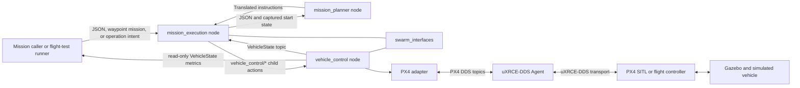
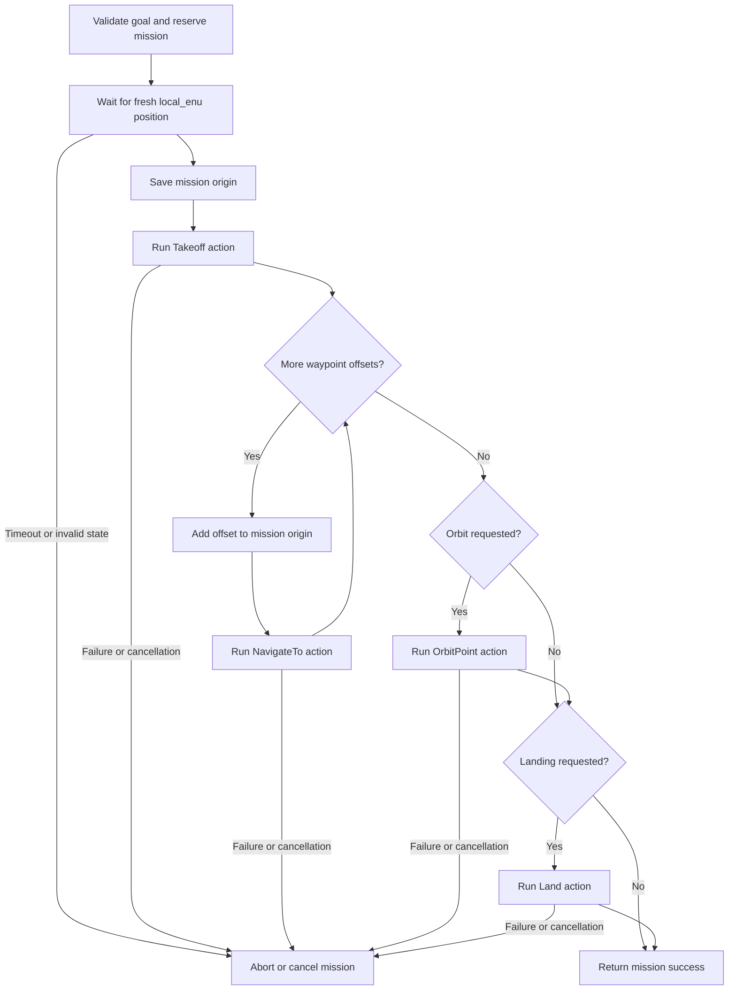

# Codebase Tour: ROS 2 Application and PX4 Flight Control

## Scope and system boundary

This repository contains the ROS 2 companion application for a PX4-controlled search-and-rescue drone. The checked-in stack targets Ubuntu 24.04, ROS 2 Jazzy, PX4 v1.17.0, and matching px4_msgs v1.17.0. The Docker build pins PX4 and px4_msgs together in the repository environment files and Docker configuration.

PX4 runs the flight controller. It performs stabilization, motor control, arming checks, mode management, and failsafe behavior. The ROS 2 application requests high-level motion through position setpoints and PX4 vehicle commands. PX4 telemetry returns to the application through DDS topics. See the project [architecture overview](../../README.md#architecture) and the official [PX4 Offboard guide](https://docs.px4.io/v1.17/en/ros2/offboard_control).

The implemented vertical slice is single-vehicle control and waypoint mission execution. Perception, collision avoidance, payload operation, and distributed task allocation are outside the implemented application. The swarm coordination package is an empty scaffold.

## Runtime architecture

The launch file starts three ROS 2 nodes. The planner node decodes JSON fleet assignments and returns mission-start instructions without flight-action clients. The vehicle-control node owns the PX4 boundary. The mission-execution node admits all application intent, checks vehicle state, selects operations, and sequences waypoint missions. An external caller, such as a CLI command or the flight-test runner, sends an action goal.

The [current system graph](current-system.dot) shows the application and simulation processes. The [future system graph](future-system.dot) labels planned swarm capabilities.

| Layer | Responsibility | Main source |
| --- | --- | --- |
| Bringup | Starts application nodes and assigns parameters and ROS namespace | [single_vehicle.launch.py, lines 10-130](../../src/drone_bringup/launch/single_vehicle.launch.py#L10) |
| Application contracts | Defines messages and long-running action request/result/feedback types | [swarm_interfaces CMakeLists, lines 9-22](../../src/swarm_interfaces/CMakeLists.txt#L9) |
| Mission authority | Admits intent, checks state, serializes requests, preempts for landing, and preserves one mission origin | [mission_execution_node.cpp](../../src/mission_execution/src/mission_execution_node.cpp) |
| JSON planner | Validates fleet assignments and expands relative or GPS path geometry | [compiler](../../src/mission_planner/mission_planner/compiler.py), [schema](../../src/mission_planner/README.md) |
| Vehicle behavior | Validates goals, streams setpoints, checks PX4 telemetry, and reports action results | [vehicle_control_node.cpp, lines 127-198](../../src/vehicle_control/src/vehicle_control_node.cpp#L127) |
| PX4 adapter | Owns PX4-specific topics, messages, acknowledgments, and frame conversion | [px4_adapter.cpp, lines 38-169](../../src/vehicle_control/src/px4_adapter.cpp#L38) |
| Autopilot | Executes PX4 flight modes and low-level control | PX4 v1.17 [ROS 2 Offboard control](https://docs.px4.io/v1.17/en/ros2/offboard_control) |

## ROS 2 concepts used in this repository

A ROS 2 node is a named participant in the ROS graph. Here, vehicle_control and mission_execution are separate rclcpp nodes with their own publishers, subscriptions, timers, and actions. Their entry points initialize ROS, construct one node, and spin it: [vehicle_control main](../../src/vehicle_control/src/main.cpp#L1) and [mission_execution main](../../src/mission_execution/src/main.cpp#L1). ROS 2 concepts are described in the official guides for [nodes](https://docs.ros.org/en/jazzy/Concepts/Basic/About-Nodes.html), [topics](https://docs.ros.org/en/jazzy/Concepts/Basic/About-Topics.html), and [actions](https://docs.ros.org/en/jazzy/Concepts/Basic/About-Actions.html).

| ROS concept | Meaning in this project | Code example |
| --- | --- | --- |
| Node | A named participant in the ROS graph | This launch file starts vehicle_control, mission_execution, and mission_planner as separate executables |
| Topic | A stream of messages for ongoing state | vehicle_control publishes VehicleState every 100 ms; mission_execution subscribes to it |
| Message | A typed data record sent on a topic or embedded in an action | VehicleState includes position, velocity, validity flags, armed/offboard/landed state, and battery |
| Action | A request that may take time and provides feedback, a terminal result, and cancellation | ExecuteWaypointMission and NavigateTo are defined as .action files |
| Service | A bounded request and response | PlanFlight translates JSON using a supplied start snapshot and vehicle ID |
| Parameter | A value supplied when the node starts | enable_flight_commands, px4_topic_prefix, telemetry_timeout_sec, and setpoint_rate_hz |
| Executor callback | A ROS-managed function invoked for a subscription, timer, or action event | PX4 telemetry subscription callbacks update adapter state |

The package builds .msg, .action, and .srv source files into generated ROS interfaces. The planner validates JSON content carried inside ExecuteFlightPlan and PlanFlight; execution uses the generated typed instructions. The action separator lines divide goal fields, result fields, and feedback fields. For example, [NavigateTo.action, lines 1-20](../../src/swarm_interfaces/action/NavigateTo.action#L1) defines an absolute local_enu destination as the goal, final success and error fields as the result, and distance-to-target as feedback.

Actions fit takeoff, navigation, landing, trajectory following, orbiting, and mission execution because those operations can last seconds or minutes. A topic carries the changing vehicle state; an action tracks one requested operation. The application exposes both endpoints in the [VehicleState and action definitions](../../src/swarm_interfaces/msg/VehicleState.msg#L1).

### Namespaces and PX4 topic prefixes

ROS names in the C++ nodes are relative names such as vehicle_state, mission_execution/takeoff, vehicle_control/takeoff, and execute_waypoint_mission. The launch namespace prefixes all three nodes and their endpoints. namespace:=uav_1 produces /uav_1/vehicle_state, /uav_1/mission_execution/takeoff, and /uav_1/vehicle_control/takeoff. Only mission execution calls the internal vehicle_control endpoints.

px4_topic_prefix is a separate full path through the PX4 fmu namespace. Its default is /fmu. A namespaced PX4 instance commonly uses /uav_1/fmu. The launch file passes these values separately at [lines 12-22 and 52-66](../../src/drone_bringup/launch/single_vehicle.launch.py#L12). This separation lets application action names and PX4 DDS topic names follow different naming rules.

### ROS callbacks and worker threads

ROS callbacks should continue processing telemetry while an action waits for PX4. Both long-running nodes queue accepted goals to a worker thread. The vehicle node's worker executes takeoff, navigation, landing, and orbit loops; its timer and DDS callbacks continue to run in the ROS executor. The mission node uses asynchronous child action clients and waits for their callbacks on its worker thread. See [vehicle worker loop](../../src/vehicle_control/src/vehicle_control_node.cpp#L828) and [mission child-action helper](../../src/mission_execution/src/mission_execution_node.cpp).

The adapter protects its telemetry snapshot with a mutex. A control loop reads a copy of the latest snapshot instead of holding a lock while it waits. This keeps telemetry updates independent from action progress checks.

### Endpoint patterns in the source

The vehicle node creates a typed publisher with a topic name and queue depth. Its 100 ms state timer calls publish_state, which fills and publishes a VehicleState message. See [publisher and timer setup](../../src/vehicle_control/src/vehicle_control_node.cpp#L169) and [state message construction](../../src/vehicle_control/src/vehicle_control_node.cpp#L730).

The mission node creates a typed subscription. Its callback copies the latest VehicleState under a mutex, records its receipt time, and wakes the worker waiting for a valid starting position. See [subscription callback](../../src/mission_execution/src/mission_execution_node.cpp).

An action server takes three callbacks: a goal callback validates and reserves a goal, a cancel callback accepts or rejects cancellation, and an accepted callback queues the work. The Takeoff server shows the pattern in [vehicle_control_node.cpp, lines 178-198](../../src/vehicle_control/src/vehicle_control_node.cpp#L178). The worker later publishes feedback and a terminal result.

An action client names the action type and relative endpoint. The mission node creates internal clients for Takeoff, NavigateTo, FollowTrajectory, OrbitPoint, and Land in the [mission source](../../src/mission_execution/src/mission_execution_node.cpp). The child-action helper uses async_send_goal, forwards feedback, and stores the result in a callback in the [mission source](../../src/mission_execution/src/mission_execution_node.cpp).

The default single-vehicle application endpoints are:

| Endpoint | Type | Owner |
| --- | --- | --- |
| /vehicle_state | swarm_interfaces/msg/VehicleState topic | Published by vehicle_control |
| /mission_execution/takeoff | swarm_interfaces/action/Takeoff | Public command served by mission_execution |
| /mission_execution/navigate_to | swarm_interfaces/action/NavigateTo | Public command served by mission_execution |
| /mission_execution/follow_trajectory | swarm_interfaces/action/FollowTrajectory | Public command served by mission_execution |
| /mission_execution/orbit_point | swarm_interfaces/action/OrbitPoint | Public command served by mission_execution |
| /mission_execution/land | swarm_interfaces/action/Land | Public command served by mission_execution |
| /mission_execution/execute_flight_plan | swarm_interfaces/action/ExecuteFlightPlan | JSON mission served by mission_execution |
| /mission_planner/plan_flight | swarm_interfaces/srv/PlanFlight | Planning-only service served by mission_planner |
| /execute_waypoint_mission | swarm_interfaces/action/ExecuteWaypointMission | Served by mission_execution |

The corresponding internal endpoints are `/vehicle_control/{takeoff,navigate_to,follow_trajectory,orbit_point,land}`. Their sole application client is mission execution. Public operations retain child feedback and measured result fields. Conflicting ordinary requests are rejected. An explicit landing interrupts ordinary work, waits for the active child terminal result, and then selects landing. Unconfirmed child termination blocks new child dispatch and returns failure within the documented deadlines. Public landing cancellation is rejected after admission. See the [mission interface](../../src/mission_execution/README.md).

The [JSON handoff](JSON-FLIGHT-PLANS.md) routes JSON content into mission execution, through the planning-only service, and back to the executor for dispatch. GPS translation uses validity-gated geographic origin fields and a frame revision from VehicleState. Frame changes invalidate the translated mission. Planned swarm and operator instructions and perception/detection results also enter mission execution. The planned priority order is safety landing, urgent special instructions, then the normal planned path. Swarm protocols, perception, arbitration, and route-resume policies remain deferred.

## The PX4 and ROS 2 boundary

PX4 publishes internal uORB state through its uXRCE-DDS client. The client communicates with the Micro XRCE-DDS Agent, which participates in the ROS 2 DDS network. The project runs the agent separately from the application launch. The [PX4 uXRCE-DDS guide](https://docs.px4.io/v1.17/en/middleware/uxrce_dds) describes the PX4 client and companion-side agent.

The ROS application needs px4_msgs definitions that match the PX4 build. The project pins both to v1.17.0. PX4's bridged topic list is also version-specific. The adapter subscribes to PX4 outputs such as /fmu/out/vehicle_local_position_v1 and publishes PX4 inputs such as /fmu/in/trajectory_setpoint. The v1 suffix is part of the project's PX4 v1.17 topic contract.

PX4 and application interfaces are deliberately separated:

- swarm_interfaces contains application-level actions and messages.
- px4_msgs appears only in vehicle_control.
- mission_execution asks for application actions and uses VehicleState. It does not know PX4 message types or topic names.
- px4_adapter translates between the application contract and PX4's DDS contract.

The mission API uses application actions with local_enu positions. The adapter maps those actions to PX4 message types, command IDs, and NED coordinates. The dependency boundary is visible in [vehicle_control/CMakeLists.txt](../../src/vehicle_control/CMakeLists.txt#L7) and [mission_execution/CMakeLists.txt](../../src/mission_execution/CMakeLists.txt#L7).

The adapter uses best-effort keep-last-one QoS for high-rate telemetry and setpoint streams, and reliable keep-last-one QoS for vehicle commands. See [px4_stream_qos and px4_command_qos](../../src/vehicle_control/src/px4_adapter.cpp#L24). PX4's ROS 2 integration requires compatible topic names, message definitions, and QoS.

### What a position setpoint does

OffboardControlMode tells PX4 which kind of external setpoint is active. The adapter sets position=true. TrajectorySetpoint carries the requested NED position. Unused velocity, acceleration, jerk, yaw, and yaw-speed fields are set to NaN, which tells PX4 that those setpoints are unspecified. The adapter publishes both messages together in [px4_adapter.cpp, lines 136-169](../../src/vehicle_control/src/px4_adapter.cpp#L136).

PX4 requires a continuing OffboardControlMode stream before entering Offboard and while the mode is active. This project defaults to a 20 Hz stream, validates the configured rate between 2 and 100 Hz, and streams for one second before requesting Offboard during takeoff. The timer is set up in [vehicle_control_node.cpp, lines 130-176](../../src/vehicle_control/src/vehicle_control_node.cpp#L130). PX4's v1.17 example documents the prestream and ongoing stream requirements in its [Offboard implementation notes](https://docs.px4.io/v1.17/en/ros2/offboard_control).

The timer continues publishing the current target while PX4 remains airborne in Offboard. Navigation updates the shared target position; the timer publishes that target at its configured rate. The action loop checks telemetry and decides when to return a result. The timer and the action loop therefore have separate jobs: one maintains the setpoint stream, and one supervises the requested operation.

A VehicleCommandAck confirms PX4's response to a command. The application also waits for state telemetry to show the requested transition. The transition helper captures an acknowledgment generation, publishes the command, matches a later acknowledgment, and checks a telemetry predicate in [vehicle_control_node.cpp, lines 582-696](../../src/vehicle_control/src/vehicle_control_node.cpp#L582). The code treats command delivery and observed mode change as separate facts.

## Coordinate conventions

Application positions use local_enu in meters from PX4's local-position origin:

| Axis | Application meaning | Positive direction |
| --- | --- | --- |
| X | East | East |
| Y | North | North |
| Z | Up | Up |

PX4's local position and trajectory setpoint messages use NED: north, east, down. The adapter converts an application vector (east, north, up) to PX4 (north, east, down) by swapping X and Y and negating Z. For example, (3, 2, 1) local_enu becomes (2, 3, -1) NED. The conversion is implemented in [coordinates.cpp, lines 22-30](../../src/vehicle_control/src/coordinates.cpp#L22) and applied to telemetry and outgoing setpoints in [px4_adapter.cpp, lines 54-85 and 136-165](../../src/vehicle_control/src/px4_adapter.cpp#L54).

Yaw uses radians. Application yaw is counterclockwise from east. The adapter transforms it to PX4's NED heading convention before publishing. Navigation points remain absolute local_enu positions when yaw changes. The yaw calculation and rate-limited look-at behavior are in [vehicle_control_node.cpp, lines 74-85 and 759-809](../../src/vehicle_control/src/vehicle_control_node.cpp#L74).

Most actions use local_enu. OrbitPoint is an exception at the PX4 command boundary: PX4's DO_ORBIT command takes a geographic center and altitude. vehicle_control converts the local orbit center using PX4's current global reference, then sends the global center as command parameters. The conversion uses a spherical-earth local projection in [coordinates.cpp, lines 38-92](../../src/vehicle_control/src/coordinates.cpp#L38); the PX4 command fields are assembled in [px4_adapter.cpp, lines 257-268](../../src/vehicle_control/src/px4_adapter.cpp#L257).

## Mission state flow

mission_execution exposes ExecuteWaypointMission alongside its public operation actions. All share one ordinary command slot. The node validates the incoming mission goal. It waits for a fresh, valid VehicleState in local_enu, records its position as mission_origin, then sends a Takeoff action. The implementation begins at [mission_execution_node.cpp](../../src/mission_execution/src/mission_execution_node.cpp) and captures the origin at [mission source](../../src/mission_execution/src/mission_execution_node.cpp).

Every waypoint target is computed from that one origin. If mission_origin is (x0, y0, z0), an offset (3, 0, 2) becomes (x0 + 3, y0, z0 + 2). The next offset is not added to the previous waypoint. The code adds each offset to the stored mission_origin at [mission_execution_node.cpp](../../src/mission_execution/src/mission_execution_node.cpp). The action contract states the same rule in [ExecuteWaypointMission.action, lines 1-10](../../src/swarm_interfaces/action/ExecuteWaypointMission.action#L1).

The mission sequence is:

The mission's optional look-at point and orbit center use offsets from the same origin. The executor converts them into absolute local_enu values before sending child goals. Orbit runs after the waypoint list and before optional landing. See [mission execution](../../src/mission_execution/src/mission_execution_node.cpp).

Mission cancellation propagates to the active child action. The child helper sends a cancel request and waits for a terminal result. A bounded drain timeout aborts the parent, reports unknown child termination, and blocks subsequent child dispatch until the child result arrives. See [run_child_action](../../src/mission_execution/src/mission_execution_node.cpp).

## Vehicle-control state and action flows

There is no single enum that names every flight phase. GoalKind labels the type of goal being admitted. The live control state is represented by action status, PX4 telemetry, the active-goal reservation, target position/yaw, and the setpoint-stream flags. These fields are declared in [vehicle_control_node.hpp, lines 51-59 and 122-160](../../src/vehicle_control/include/vehicle_control/vehicle_control_node.hpp#L51).

Before an action is accepted, vehicle_control checks the command-enable parameter, telemetry freshness, required yaw/global data, active-goal status, and PX4's current armed/mode/landed state. The shared gate is [reserve_goal](../../src/vehicle_control/src/vehicle_control_node.cpp#L399). Only one vehicle action can reserve the control slot at a time. The launch default for enable_flight_commands is false in [single_vehicle.launch.py, lines 31-35](../../src/drone_bringup/launch/single_vehicle.launch.py#L31).

| Parameter | Default | Runtime role |
| --- | --- | --- |
| enable_flight_commands | false | Rejects flight-action goals until the operator enables them |
| setpoint_rate_hz | 20.0 | Sets the Offboard control-timer frequency; accepted range is 2 to 100 Hz |
| telemetry_timeout_sec | 1.0 | Maximum age used by control-telemetry freshness checks |
| default_navigation_timeout_sec | 30.0 | Timeout used when a navigation or trajectory goal supplies zero |
| default_position_tolerance_m | 0.5 | Default position acceptance radius |
| command_ack_timeout_sec | 2.0 | Acknowledgment wait for a PX4 vehicle command |
| transition_timeout_sec | 5.0 | Telemetry confirmation deadline for a requested PX4 state change |
| max_orbit_radius_m / max_orbit_speed_mps / max_orbit_center_distance_m | 20.0 / 3.0 / 100.0 | Bounds accepted for OrbitPoint goals |

The constructor declares and validates these values in [vehicle_control_node.cpp, lines 127-167](../../src/vehicle_control/src/vehicle_control_node.cpp#L127). The launch file exposes the application parameters in [single_vehicle.launch.py, lines 31-49](../../src/drone_bringup/launch/single_vehicle.launch.py#L31).

Takeoff is a concrete state sequence:

1. Validate a finite positive altitude and reserve the vehicle goal.
2. Capture the current local_enu position.
3. Stream a position target for one second.
4. Request Offboard and wait for both acknowledgment and Offboard telemetry.
5. Request arming and wait for both acknowledgment and armed telemetry.
6. Set target Z to the captured Z plus the requested altitude.
7. Continue setpoint streaming until position is within the configured tolerance.
8. Return success. On cancellation or failure, command a hold at the latest valid position.

The implementation is in [execute_takeoff, lines 859-985](../../src/vehicle_control/src/vehicle_control_node.cpp#L859). A Takeoff goal's altitude is a vertical displacement from the accepted starting position, as specified in [Takeoff.action](../../src/swarm_interfaces/action/Takeoff.action#L1).

| Action | Goal meaning | Completion and recovery path |
| --- | --- | --- |
| Takeoff | Vertical altitude above the captured starting point | Confirms Offboard, arms, climbs to the target, and reports success within the default position tolerance |
| NavigateTo | Absolute local_enu position, with optional look-at target | Checks target distance; optional yaw must also settle for 0.5 seconds |
| FollowTrajectory | Timed absolute local_enu points with optional yaw | Interpolates targets by elapsed time and requires the last point to settle |
| OrbitPoint | Absolute local_enu orbit center, radius, direction, speed, and revolutions | Requests PX4's native orbit mode, measures revolutions from telemetry, then restores and confirms Offboard position hold |
| Land | Request a controlled PX4 landing | Waits for landed state, disarms, selects Auto Loiter, and confirms all three states |

Navigation updates the shared setpoint target and checks distance in its worker loop. If look_at_target is enabled, yaw points toward the requested horizontal bearing. Position control does not rotate with yaw. Cancellation replaces the target with the latest valid position and keeps the stream active. See [navigation goal setup](../../src/vehicle_control/src/vehicle_control_node.cpp#L200) and [execute_navigation](../../src/vehicle_control/src/vehicle_control_node.cpp#L988).

FollowTrajectory interpolates between timed points. Its validator requires at least two points, a zero-time first point, increasing timestamps, finite values, a bounded path envelope, and speed and acceleration limits. Optional yaw is interpolated with wrapped-angle math. See [trajectory validation and interpolation](../../src/vehicle_control/src/trajectory.cpp#L47) and [trajectory execution](../../src/vehicle_control/src/vehicle_control_node.cpp#L1151).

OrbitPoint delegates circle tracking to PX4's DO_ORBIT command. vehicle_control checks entry conditions, converts the center to a global coordinate, stops its position stream while PX4 controls Orbit mode, and measures angular progress from fresh position samples. A missing acknowledgment is not resent when telemetry confirms PX4 entered Orbit. At completion or cancellation, the action attempts to restore Offboard position hold. The progress calculation is isolated in [orbit_progress.cpp](../../src/vehicle_control/src/orbit_progress.cpp#L16); execution and recovery are in [vehicle_control_node.cpp, lines 1473-1554 and 1556-1856](../../src/vehicle_control/src/vehicle_control_node.cpp#L1473).

Land sends PX4's NAV_LAND command and waits for land-detected telemetry. After PX4 reports landed, the action disarms, selects Auto Loiter, and checks that the vehicle is landed, disarmed, and no longer in Offboard. Cancellation is rejected after the landing command starts. See [land action setup](../../src/vehicle_control/src/vehicle_control_node.cpp#L359) and [execute_land](../../src/vehicle_control/src/vehicle_control_node.cpp#L1336).

## Package map

| Package | Current responsibility | Useful entry points |
| --- | --- | --- |
| swarm_interfaces | Application ROS messages and actions | [messages](../../src/swarm_interfaces/msg), [actions](../../src/swarm_interfaces/action), [package build](../../src/swarm_interfaces/CMakeLists.txt#L9) |
| vehicle_control | PX4 adapter, telemetry, coordinate conversion, setpoint stream, and flight actions | [node](../../src/vehicle_control/src/vehicle_control_node.cpp#L127), [adapter](../../src/vehicle_control/src/px4_adapter.cpp#L38), [package guide](../../src/vehicle_control/README.md) |
| mission_execution | Sole command authority, public actions, state admission, landing preemption, and mission sequencing | [node](../../src/mission_execution/src/mission_execution_node.cpp), [package guide](../../src/mission_execution/README.md) |
| mission_planner | JSON validation, fleet assignment selection, geometry expansion, and geographic projection | [package guide](../../src/mission_planner/README.md), [compiler](../../src/mission_planner/mission_planner/compiler.py) |
| drone_bringup | Application launch and ROS parameters | [launch file](../../src/drone_bringup/launch/single_vehicle.launch.py#L10), [package guide](../../src/drone_bringup/README.md) |
| flight_test | SITL action client, state recorder, and outcome metrics | [runner](../../src/flight_test/flight_test/runner.py#L114), [test cases and artifacts](../../src/flight_test/README.md) |
| swarm_coordination | Empty scaffold for future coordination behavior | [package README](../../src/swarm_coordination/README.md) |

The SearchRegion, TaskAssignment, and VictimReport messages are provisional contracts. Their definitions do not mean that search allocation or perception is implemented. The package build lists those messages in [swarm_interfaces/CMakeLists.txt](../../src/swarm_interfaces/CMakeLists.txt#L9), while the current package documentation marks swarm coordination as unimplemented.

## Reading the repository in execution order

1. Read [single_vehicle.launch.py](../../src/drone_bringup/launch/single_vehicle.launch.py#L10) to see which nodes start and how names and parameters are passed.
2. Read [VehicleState.msg](../../src/swarm_interfaces/msg/VehicleState.msg#L1) and [NavigateTo.action](../../src/swarm_interfaces/action/NavigateTo.action#L1) to learn the application contract.
3. Read [mission_execution_node.cpp](../../src/mission_execution/src/mission_execution_node.cpp) to trace a mission from origin capture through its child actions.
4. Read [vehicle_control_node.cpp](../../src/vehicle_control/src/vehicle_control_node.cpp#L399) to inspect goal admission, then follow execute_takeoff or execute_navigation.
5. Read [px4_adapter.cpp](../../src/vehicle_control/src/px4_adapter.cpp#L38) to see the PX4 DDS endpoints and typed message conversion.
6. Read [coordinates.cpp](../../src/vehicle_control/src/coordinates.cpp#L22) to verify the ENU/NED conversion with a numeric example.
7. Read [flight_test/README.md](../../src/flight_test/README.md) to see which integrated behaviors are exercised in SITL and what artifacts the runner records.

The flight-test runner subscribes to VehicleState for read-only measurements and creates command clients exclusively for mission execution. Its trajectory, orbit, navigation cancellation, and recovery landing intents all pass through mission execution. It records state samples, commanded trajectories, action feedback, assertions, and result reports. It does not launch PX4, Gazebo, or the application. See [FlightTestRunner initialization](../../src/flight_test/flight_test/runner.py#L114).

## ROS graph inspection

These commands inspect the running graph and interface definitions without sending a flight goal:

    ros2 node list
    ros2 node info /vehicle_control
    ros2 topic echo --once /vehicle_state
    ros2 action list -t
    ros2 interface show swarm_interfaces/action/ExecuteWaypointMission
    ros2 topic info /fmu/out/vehicle_local_position_v1 --verbose

With a ROS namespace, substitute names such as /uav_1/vehicle_state and /uav_1/mission_execution/takeoff. PX4 DDS names follow px4_topic_prefix independently.

## Reference material

- ROS 2 Jazzy: [nodes](https://docs.ros.org/en/jazzy/Concepts/Basic/About-Nodes.html), [topics](https://docs.ros.org/en/jazzy/Concepts/Basic/About-Topics.html), and [actions](https://docs.ros.org/en/jazzy/Concepts/Basic/About-Actions.html)
- PX4 v1.17: [ROS 2 Offboard control](https://docs.px4.io/v1.17/en/ros2/offboard_control)
- PX4 v1.17: [uXRCE-DDS bridge](https://docs.px4.io/v1.17/en/middleware/uxrce_dds)
- PX4 v1.17: [bridged DDS topic configuration](https://github.com/PX4/PX4-Autopilot/blob/v1.17.0/src/modules/uxrce_dds_client/dds_topics.yaml)
- Project: [architecture diagrams](README.md), [simulation process guide](../simulation/HOW-IT-WORKS.md), and [individual flight tests](../testing/README.md)
