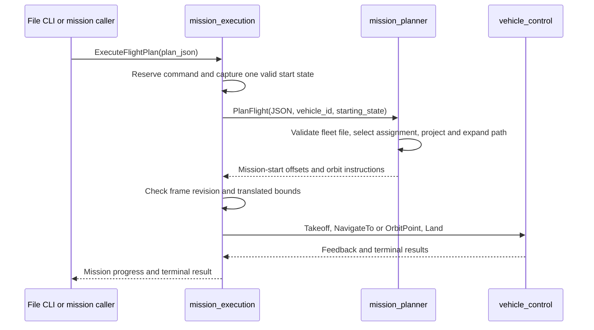

# JSON flight plans

## Implemented handoff

The action carries high-level JSON content. The planning service returns typed application instructions. Neither contains PX4 messages or DDS commands. Only `mission_execution` selects and dispatches vehicle operations. Only `vehicle_control` depends on PX4 messages and converts application ENU positions to PX4 NED positions.

`VehicleState` exposes a validity-gated geographic local-frame reference and a revision. The adapter changes the revision when the reference or estimator position-reset counters change. A JSON mission retains one start snapshot from compilation through execution. A frame reset invalidates the translation and aborts the mission. Planner timeout and cancellation remove the pending request; a late service response cannot start flight.

## Coordinate and assignment contracts

The [schema guide](../../src/mission_planner/README.md) defines version 2 vehicle assignments, relative coordinates, shared geographic origins, AMSL heights, path types, and rejection bounds. Version 1 preserves the SAR single-drone `local_enu` origin contract. New fleet files use explicit vehicle IDs and version 2.

Every vehicle receives the same file content and selects its own assignment using a configured stable ID. ROS namespaces address nodes and services. Vehicle IDs identify assignments and can remain stable when deployment namespaces change. Neither an estimator origin nor a ROS namespace defines a shared swarm coordinate frame. Relative routes use each vehicle start; geographically anchored routes use a shared world location.

The service has no flight side effects. A coordinator can validate or compile assignments without becoming a second vehicle-action client. The current file CLI submits to one executor at a time. Fleet delivery and coordination remain outside the planner.

## Extension requirements

| Capability | Required extension | Current status |
| --- | --- | --- |
| Fleet delivery | Submit the same document to every intended namespace and collect per-vehicle admission/results | Manual per-vehicle CLI submission; two-namespace automated integration coverage |
| Area allocation | Generate disjoint explicit assignments from a search region and stable vehicle IDs | Assignments authored in JSON; no allocator |
| Synchronized execution | Define a clock, readiness barrier, start deadline, and failed-participant policy | No synchronized starts |
| Collision avoidance | Define separation, shared altitude policy, trajectory constraints, and runtime conflict handling | No separation enforcement |
| Peer failure/reassignment | Define peer health, ownership transfer, progress checkpoints, and duplicate-work policy | Empty swarm coordination scaffold |
| Route replacement | Define plan identity, revision, authorization, expiry, interruption, and resume rules | One admitted ordinary mission; explicit landing preempts |
| Perception or urgent operator intent | Define priority and retention rules before intent enters the executor | Future priority policy documented in the architecture guide |
| Terrain or variable-altitude paths | Version the altitude datum and per-point height semantics | Constant path altitude and AMSL GPS heights only |

Schema changes that alter coordinate meaning require a new version. Unknown fields fail validation. A future coordinator must submit intent through mission execution and preserve the one-authority vehicle-control boundary. Multi-vehicle PX4 simulation and physical swarm validation remain required before using fleet assignments for concurrent real flights.
