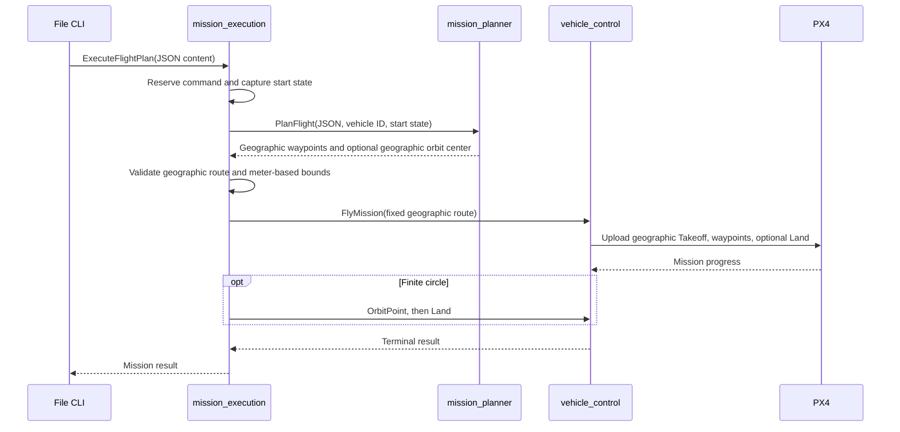

# JSON planning and execution

The [planner package guide](../../src/mission_planner/README.md) defines the JSON schema, examples, bounds, and file-submission commands.

## Planning boundary

The CLI sends file contents in the action goal. The executor never opens a caller-selected server path. The planner service accepts application messages and has no flight side effects. The executor validates its response before dispatching an internal vehicle action.

## Frames and assignments

Each executor selects its explicit assignment using `vehicle_id`. ROS namespaces address endpoints. Vehicle IDs select assignments; they do not establish a shared coordinate frame or requester identity.

Relative ENU routes use the vehicle's captured geographic start. Relative body routes also use one valid captured heading. Shared ENU routes use a geographic anchor. GPS routes use latitude/longitude and AMSL height. The planner compiles each assignment into fixed geographic destinations. Direct GPS waypoints retain their original coordinates. Geometry expansion uses metric ENU coordinates from an anchor shared across vehicles.

`VehicleState.local_frame_revision` identifies changes to the estimator's local reference. Geographic destinations remain fixed across local resets during planning and execution. A finite circle retains a geographic center until it is projected into the current local frame at handoff; subsequent local resets abort that orbit.

Cancellation or explicit landing interrupts a pending planning request. A late planning response cannot start flight. Uploaded-route cancellation confirms native Hold and ends the ROS action. JSON missions start landed and disarmed and land after successful execution.

## Fleet limits

The CLI submits to one namespace at a time. Sending the same file to several executors provides independent assignment selection. It provides no synchronized start, automatic allocation, collision avoidance, peer-health monitoring, or reassignment. ROS pause/resume, airborne plan replacement, and perception-driven detours are unimplemented.
