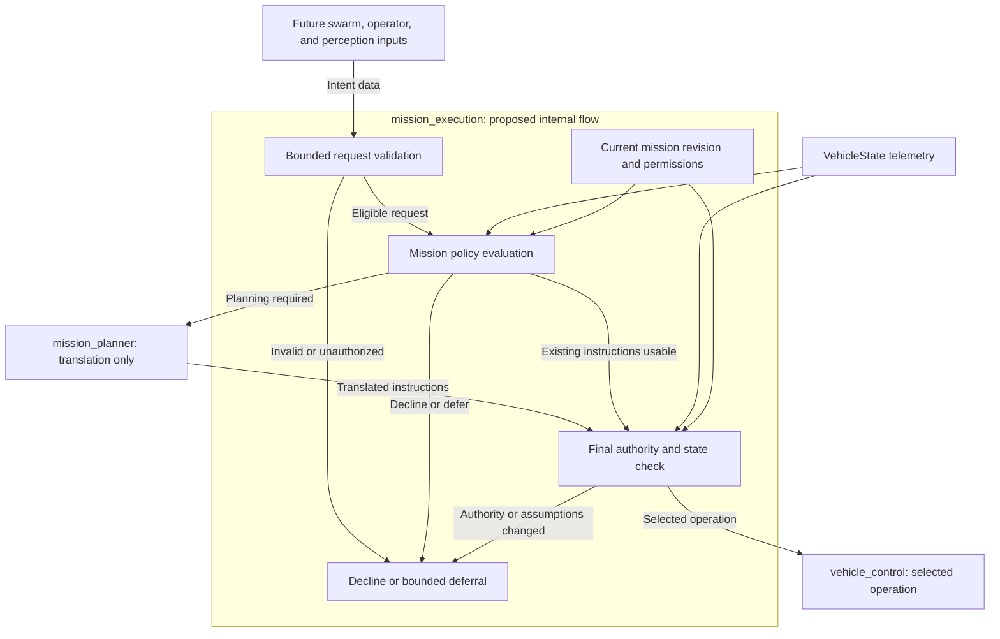

# Mission admission and arbitration

Status: Draft for future evaluation. No transport, interface, or arbitration policy in this proposal has been approved or implemented.

Baseline: The local `learn` workspace on November 9, 2026, including the JSON planner and centralized command path. The term *mission manager* refers to the existing `mission_execution` node. This proposal does not introduce another manager node.

## Design question

How should mission execution evaluate requests from swarm coordination, operators, and perception while retaining authority over the vehicle's next operation?

The review must distinguish three decisions:

1. Whether a source may submit a particular kind of request.
2. Whether that request fits the vehicle's current mission and state.
3. Whether an approved operation can execute safely at dispatch time.

An incoming request must not gain flight authority solely because its callback ran or the vehicle has no active action.

## Current implementation

| Area | Implemented behavior | Remaining decision |
| --- | --- | --- |
| Callback ownership | Server callbacks are defined in the receiving node's source. Clients send typed goal data. | No external callback or script execution is proposed. |
| Mission ingress | Public actions accept JSON plans, waypoint missions, and individual flight operations. | Which sources may use each interface during autonomous operation? |
| Admission | Goal validation and a shared reservation reject conflicting ordinary commands. State checks run before child dispatch. | Which requests advance the current mission or qualify for replacement? |
| Landing | An accepted explicit landing interrupts ordinary work, drains its child, and commits to landing. | Which sources may request landing, and which local safety conditions require it? |
| Planning | Mission execution requests translation from `mission_planner/plan_flight` and validates the returned instructions. | How are planning responses associated with future mission revisions? |
| Execution | Mission execution owns all in-repository application clients for `vehicle_control/*`. Vehicle control independently validates operations and owns PX4 integration. | How is this ownership enforced against other ROS participants? |
| Future inputs | `swarm_coordination` is an empty scaffold. Perception-driven flight and source-aware arbitration are unimplemented. | Which intents and source roles are required first? |

The current gate does not authenticate a requester or compare its intent with strategic mission objectives. An eligible request from a reachable client can start when the manager is idle. JSON structure, planning, and state validation can still fail that request before takeoff.

Source references: [mission admission and execution](../../src/mission_execution/src/mission_execution_node.cpp), [public command contracts](../../src/mission_execution/README.md), [planning service](../../src/mission_planner/mission_planner/node.py), and [swarm scaffold](../../src/swarm_coordination/README.md).

## Callbacks and flight authority

A ROS action sends goal data to an action server. The server owns goal acceptance, execution, and cancellation handling. Client feedback callbacks execute in the client process. These roles are defined in the [ROS action design](https://github.com/ros2/design/blob/gh-pages/articles/actions.md).

Our interfaces contain JSON content, coordinates, and operation parameters. They contain no uploaded functions, scripts, or plugin definitions. Mission execution's queued lambdas are local implementation code defined by that node.

The design issue is the behavior selected by a receiving callback. A callback that unconditionally dispatches every valid goal gives callers control over the sequence of requested operations. A callback that submits data for local policy evaluation leaves that selection with mission execution. Actions, services, and topic subscriptions all require an explicit policy at this boundary.

## Proposed ownership requirements

These requirements apply to any option selected during review:

- External nodes submit declarative intent, including destinations, search assignments, observations, or operator requests.
- Mission execution owns permission checks, mission selection, effective priority, replacement decisions, and vehicle-action dispatch.
- Mission planning returns geometry and instructions without admitting missions or issuing flight actions.
- Vehicle control retains independent execution checks, setpoint streaming, frame conversion, and PX4-specific handling.
- PX4 retains preflight checks, low-level control, and failsafes.
- One local mission authority controls each vehicle. A swarm coordinator does not become a second client of that vehicle's execution actions.
- Admission, cancellation, planning, and queueing have bounded resource use and documented deadlines.
- A planning response or approved request cannot remain executable after its mission revision, authority, expiry, or coordinate assumptions become invalid.

The transport must not accept executable callbacks, shell commands, scripts, or caller-selected implementation plugins as mission payloads. A future declarative behavior language would require its own bounded interpreter and authority review.

## Candidate flow inside mission execution

Every component labeled *proposed* below is future work. The existing planner and vehicle-control boundaries remain in their current packages.

Ingress validation would check size, supported request kind, source permissions, vehicle identity, and request freshness. Long planning work must run outside the receiving callback. The policy evaluator would inspect a consistent snapshot of the current mission and vehicle state before selecting work.

A deferred request would retain no permission to dispatch by itself. Selection would trigger another permission, expiry, mission-revision, and state check. Queue capacity, queue lifetime, and overload behavior require explicit limits before deferral is enabled. Rejecting unsupported concurrent requests remains an option.

Dispatch would recheck the selected mission revision and required telemetry immediately before each vehicle operation. A request superseded during planning would discard its late planning response. A frame reset would invalidate translated coordinates according to the existing JSON mission contract.

Policy evaluation and child dispatch must preserve one serialized ownership transition. A newly approved request must not race an earlier worker into issuing two vehicle operations.

## Transport options

These options concern future external intent. The existing pure planning service and internal execution actions do not require replacement for this evaluation.

| Option | Benefits | Costs and constraints | Review position |
| --- | --- | --- | --- |
| A. Action with manager-owned admission and arbitration | Existing goal, feedback, result, and cancellation lifecycle; one request can track review through completion. | Acceptance semantics must distinguish request tracking from flight approval if review continues asynchronously. Queues and preemption remain application policy. | First candidate to evaluate. |
| B. Admission service followed by an execution action | Approval is a separate observable decision; supports a caller reviewing a decision before execution. | Requires approval expiry, payload binding, and revalidation between the two requests. Adds failure states and caller coordination. | Evaluate if a separate approval step is a product requirement. |
| C. Intent topic plus decision/status topics | Supports continuous observations and one-to-many distribution. | Request correlation, expiry, acknowledgement, cancellation, and results require application contracts. Retained or repeated messages require stale-request handling. | Candidate for observations and peer status; justify any mission-submission use separately. |

ROS actions already support server acceptance/rejection, progress, terminal results, and cancellation requests. A service supplies a request/response exchange without the action lifecycle. These protocol differences are described in the [ROS action design](https://github.com/ros2/design/blob/gh-pages/articles/actions.md).

Option A is a proposal to retain the action transport while strengthening local policy. Its evaluation does not require a generic command framework or a new node. The policy can remain inside mission execution until code size, ownership, or independent testing establishes a need for another abstraction.

### Action acceptance semantics

Review must choose one meaning for acceptance on any future intent endpoint:

- **Approval at acceptance:** The goal callback performs bounded admission checks and accepts only requests selected for execution. Expensive planning and final safety validation still occur afterward.
- **Tracking at acceptance:** The callback accepts an eligible request for asynchronous policy review. Feedback identifies pending review. No flight operation starts before local approval.

Under tracking semantics, a later policy refusal ends an accepted action with an unsuccessful result and a reason. It cannot retroactively become a ROS goal rejection. Feedback and results must distinguish refusal, expiry, supersession, execution failure, and confirmed cancellation. ROS goal-state transitions are specified in the [ROS action design](https://github.com/ros2/design/blob/gh-pages/articles/actions.md).

Existing callers must not silently acquire new acceptance or queueing semantics. An implementation review must select a compatible extension or a separate versioned intent contract. Existing primitive-operation actions used by flight tests require an explicit operator/test-mode access policy before autonomous sources share them.

The interface review must also define how callers obtain machine-readable reasons for goals refused before action acceptance. ROS log output alone is insufficient for automated fleet decisions.

## Priority and source permissions

The existing architecture records this future order:

1. Locally evaluated safety conditions requiring landing.
2. Authorized urgent instructions, including operator intervention, swarm reassignment, or a perception-driven task.
3. The normal planned route.

This order does not define permission to request each operation. A payload field claiming urgency cannot grant safety priority or landing authority. Mission execution must derive effective priority from the permitted source role, request kind, current mission, and validated evidence.

Review must define equal-priority ordering, operator versus swarm precedence, urgent-request expiry, and whether a request can interrupt the current vehicle operation. Detection confidence and observation age require policy before a detection can cause an orbit or route change. The future safety classifier requires its own telemetry and failure contract.

Endpoint names and JSON `vehicle_id` values identify resources. They do not establish requester identity. A future enforcement design must bind source roles to authenticated communication permissions or a trusted ingress boundary. The standard goal callback currently used by this project receives a goal UUID and goal payload; a payload `source_id` alone cannot establish that binding.

ROS 2 DDS-Security provides authentication and access-control mechanisms through deployment configuration. Application policy must still decide which permitted intent fits the current mission. See the [ROS DDS-Security design](https://github.com/ros2/design/blob/gh-pages/articles/180_ros2_dds_security.md). Enforcement evaluation must cover internal vehicle-control actions and direct PX4 input topics, including participants outside this repository. Restricting only the public mission endpoint would leave other command paths reachable.

## Preemption, cancellation, and failures

| Event | Proposed requirement or retained constraint |
| --- | --- |
| Ordinary request arrives during an active mission | Continue the active mission unless local policy explicitly selects replacement. Reject or defer the new request with a reason. |
| Replacement is approved | Cancel and drain the active child before issuing replacement work. Record which mission superseded which request. |
| Child termination is unknown | Retain the existing block on further child dispatch. Report the unknown outcome and preserve the operator/PX4 recovery path. |
| Caller cancels a pending proposal | Remove it from consideration and confirm that it cannot dispatch later. |
| Caller cancels active work | Request child cancellation and report cancellation only after the required terminal confirmation. |
| Explicit landing is accepted | Retain committed landing and child-drain behavior. Complete authorization before accepting the landing request. |
| Telemetry is stale or the local frame changes | Invalidate affected dispatch decisions and translations. A hold or landing maneuver still requires a usable execution boundary and valid inputs for that operation. |
| Planner times out or responds after supersession | End or reevaluate the request according to policy; the late response cannot issue flight work. |
| Client disconnects or manager restarts | Reconcile known vehicle and child-action state before admitting new work. Automatic resume requires a separate approved policy. |

Interruption does not imply automatic route resumption. Review must define whether to discard, retain, replan, or require resubmission of the interrupted route. A retained route must preserve its coordinate origin and frame assumptions or be translated again under an explicit new-origin contract.

## Candidate request and decision information

This table identifies information to evaluate. It does not define a new ROS message, JSON schema version, endpoint name, or mandatory field set.

| Information | Purpose and constraint |
| --- | --- |
| Request ID and revision | Correlate decisions and retries. Reusing an ID with changed content requires explicit revision handling. |
| Vehicle and assignment identity | Prevent routing or replay into another vehicle's mission. |
| Mission ID and expected mission revision | Detect requests and planning responses based on an obsolete mission. |
| Request kind and declarative payload | Bound supported intent, such as a search assignment or observation. |
| Requester role binding | Establish permissions through the chosen trusted ingress mechanism. A caller-supplied label is insufficient. |
| Expiry or validity window | Prevent delayed requests from becoming current work. Clock synchronization and clock-reset behavior require definition. |
| Interruption preference | Express the caller's requested handling. Mission execution determines whether interruption is permitted. |
| Decision and reason | Report pending review, decline, deferral, selection, supersession, or expiry independently of flight progress. |

Retries require deduplication rules before fleet delivery is automated. A lost response must not cause a second takeoff or duplicate assignment execution. Approval references under option B must bind to the approved payload and expire; execution must revalidate current authority and state.

## Scenarios for design review

| Scenario | Required property | Policy still to choose |
| --- | --- | --- |
| A drone searches region A; the swarm proposes region B | Arrival alone cannot replace A. Mission execution records its decision. | Reject B, defer B, or approve reassignment under a defined ownership rule. |
| A perception node reports a possible person during transit | Observation data cannot directly invoke an orbit callback or a vehicle action. | Confidence, evidence age, operator involvement, and interruption threshold. |
| An authorized operator requests landing during planning | Planning cannot produce a later takeoff after landing was committed. | Which operator identities and modes grant landing permission. |
| Two permitted sources submit urgent requests together | Arrival races cannot create concurrent child operations. | Equal-priority ordering and retained-request lifetime. |
| A coordinator retries an assignment after losing contact | Request retries cannot silently repeat completed work. | Deduplication retention and status reconciliation after restart. |
| Several vehicles receive a fleet revision | Each local executor retains admission authority and reports its own result. | Fleet rollback, partial acceptance, synchronization, and reassignment ownership. |

Per-vehicle admission does not establish collision avoidance or coordinated fleet commitment. Those behaviors require the separate work listed in the [JSON flight-plan extension requirements](JSON-FLIGHT-PLANS.md#extension-requirements).

## Evaluation and implementation gates

1. Record a source-role matrix and resolve action acceptance semantics. Specify the behavior for busy, unauthorized, expired, duplicate, and equal-priority requests.
2. Exercise the scenario table with a policy prototype that cannot dispatch flight actions. Bound queue capacity, review time, and retained decision history. Keep numeric limits explicit in the reviewed specification.
3. Test deterministic policy decisions against mission revisions, stale telemetry, duplicate delivery, and source-role changes. Test simultaneous approval, cancellation, and dispatch events.
4. Connect the selected policy to namespaced fake vehicle backends. Verify that declined and pending requests produce no child goals, replacements drain old children, and late planning responses cannot dispatch.
5. Test the chosen access-control deployment with an unauthorized ROS participant. Verify restrictions on public intent, internal execution actions, and PX4 command/setpoint inputs. Test the operator recovery path separately.
6. Run controlled SITL for approved replacement, landing during review, cancellation, coordinator loss, and frame reset. Retain the existing flight thresholds and record any failure.
7. Run multi-vehicle SITL before physical fleet trials. Validate one physical vehicle and its recovery procedure before concurrent physical flights.

Existing [command architecture validation](../testing/COMMAND-ARCHITECTURE-VALIDATION.md) and [JSON planner validation](../testing/JSON-PLANNER-VALIDATION.md) describe the baseline checks. They do not validate this proposed policy. The recorded FT-03 orbit-yaw and FT-06 cancellation hold-drift failures remain unresolved baseline flight issues.

## Decisions to record when work resumes

| Decision | Required review output |
| --- | --- |
| Transport and acceptance | Select A, B, or C for each request category; define the exact point of flight approval. |
| Source permissions | Map operator, swarm, perception, planner, and test roles to permitted intents and enforced communication paths. |
| Current-mission ownership | Define who can assign, replace, cancel, and resume work, including partial fleet acceptance. |
| Priority and fairness | Define safety inputs, urgent thresholds, ties, expiry, and starvation handling. |
| Resource and time limits | Set queue bounds, review deadlines, clock assumptions, deduplication retention, and overload behavior. |
| Failure recovery | Define coordinator loss, client disappearance, manager restart, unknown child termination, and operator takeover. |
| Compatibility | Record effects on JSON submission, waypoint missions, primitive-operation actions, CLI behavior, and FT-00 through FT-06. |
| Evidence for adoption | Attach policy scenarios, concurrency tests, access-control results, and SITL reports before marking this draft accepted. |

Assumptions for evaluation: one mission authority per vehicle; declarative intent from external sources; no approved requester-identity mechanism or fleet consensus protocol. All policy, security, interface, and runtime work in this proposal remains unimplemented. No implementation deadline is assigned by this document.
