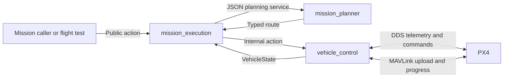

# Application architecture

The application targets ROS 2 Jazzy and PX4 v1.17.0. The [root guide](../../README.md#simulation-flight-procedure) provides the simulation commands. [Package guides](../../README.md#architecture) describe individual APIs.

## Nodes and command ownership

`drone_bringup` launches three nodes: `mission_execution`, `mission_planner`, and `vehicle_control`. PX4, Gazebo, the DDS agent, and QGroundControl run separately.



`mission_execution` validates intent, captures mission state, admits one ordinary command, and dispatches child actions. An explicit landing request interrupts ordinary work and waits for the child to terminate before dispatching landing. An unknown child outcome blocks further dispatch.

`mission_planner` parses JSON, selects the configured vehicle assignment, generates route geometry, and returns application instructions. Its planning service issues no flight commands.

`vehicle_control` owns PX4 message types, frame conversion, telemetry freshness checks, mode transitions, MAVLink mission upload, and internal action execution. `flight_test` submits public actions and reads application telemetry for independent measurements.

Internal endpoint names express application ownership. They do not enforce access control against other ROS participants.

## ROS communication concepts

| Mechanism | Use in this repository | Caller-visible behavior |
| --- | --- | --- |
| Action | `execute_waypoint_mission`, `mission_execution/navigate_to`, and other flight operations | Goal acceptance, progress feedback, cancellation, and a terminal result |
| Service | `mission_planner/plan_flight` | One planning request and response, with no flight side effects |
| Topic | `vehicle_state` and PX4 telemetry | A stream of typed state samples; receiving a sample does not request a maneuver |

Action results and state topics travel independently. An action result can arrive before the state subscriber observes the resulting mode or touchdown. Callers that require a terminal vehicle state wait for fresh telemetry as well as the result.

Long-running operations execute on worker threads. ROS callbacks continue to process telemetry, cancellation, and child-action responses during execution.

## Flight modes and execution

| Operation | Flight-controller behavior | Application work during execution |
| --- | --- | --- |
| Waypoint or JSON route | Stored PX4 mission with Takeoff, waypoints, and ordinary Land | Monitor progress and state; handle cancellation |
| Standalone Takeoff or NavigateTo | Offboard position control | Publish setpoints and monitor completion |
| FollowTrajectory | Offboard timed position and optional yaw setpoints | Interpolate the requested schedule and check the final target |
| OrbitPoint | Native PX4 `DO_ORBIT` | Count measured revolutions, check requested heading, and restore Offboard hold |
| Standalone Land | Native PX4 Auto Land | Confirm touchdown, disarming, and Auto Loiter |

An uploaded route needs no application Offboard stream. Standalone Offboard operations require the continuing stream; the default rate is 20 Hz. Native mission cancellation confirms Hold. Standalone navigation and orbit cancellation retain Offboard hold. [Onboard missions](PX4-ONBOARD-MISSIONS.md) documents the changed acceptance and interruption contracts.

## Coordinates and vehicle identity

Compiled mission destinations use WGS84 latitude/longitude and AMSL altitude. Metric planning uses ENU. Relative ENU and body-frame inputs resolve once from a captured geographic start and optional captured heading. Local telemetry, trajectories, and orbit execution use `local_enu` in meters: X east, Y north, Z up. PX4 local positions use NED: X north, Y east, Z down. The adapter maps `(east, north, up)` to `(north, east, down)` at the PX4 boundary.

All relative mission waypoints use one captured starting position. Earlier waypoints do not change that origin. Standalone NavigateTo accepts WGS84/AMSL targets, relative ENU offsets, forward/left/up offsets at captured yaw, and legacy absolute local ENU targets. The [coordinate guide](COORDINATES.md) provides commands and the research basis.

`VehicleState` supplies validity flags, freshness information, and a local-frame revision. Position/status freshness defaults to 1 second; land state allows at least 2 seconds to cover PX4's 1-second unchanged-state publication period. Its geographic reference places the local origin in latitude, longitude, and AMSL altitude. The planner and executor preserve geographic mission destinations through upload. A local-frame reset alone does not invalidate geographic destinations. An orbit center is projected at handoff and then depends on that local reference. `VehicleState.global_position_valid` gates the current geographic estimate.

| Setting | Purpose | Root-launch default |
| --- | --- | --- |
| `namespace` | Prefix application node and endpoint names | Empty |
| `vehicle_id` | Select a JSON fleet assignment | `uav_1`, or the namespace with slashes replaced by underscores |
| `px4_topic_prefix` | Select PX4 DDS topics | `/fmu` |
| `px4_system_id` | Address the flight controller and match MAVLink discovery | `1` |
| `mission_connection_url` | Connect the mission protocol client | `udpin://0.0.0.0:14540` |

These settings are independent. A ROS namespace configures neither the PX4 DDS namespace nor a MAVLink destination. Multiple vehicles require matching identities and separate mission endpoints. The [JSON flow](JSON-FLIGHT-PLANS.md) explains relative, shared-origin, and geographic assignments.

## Supported scope

Single-vehicle waypoint execution and individual flight operations are implemented. JSON version 2 supports explicit per-vehicle assignments. Two-namespace ROS tests cover assignment selection with simulated action backends.

`swarm_coordination` is an empty scaffold. Peer discovery, automatic allocation, peer failure handling, collision avoidance, perception-driven flight, urgent-intent arbitration, ROS mission resume, and airborne route replacement are unimplemented. Multi-vehicle PX4 flight and physical hardware remain outside the completed validation.

## Architecture diagram

[`current-system.dot`](current-system.dot) includes the application nodes, simulation processes, and communication paths. Install Graphviz and GNU Make, then run from the repository root:

```bash
make diagrams
```

The command generates SVG and PNG files under `docs/architecture/generated/`. Generated files are ignored by Git. `make clean-diagrams` removes them.
