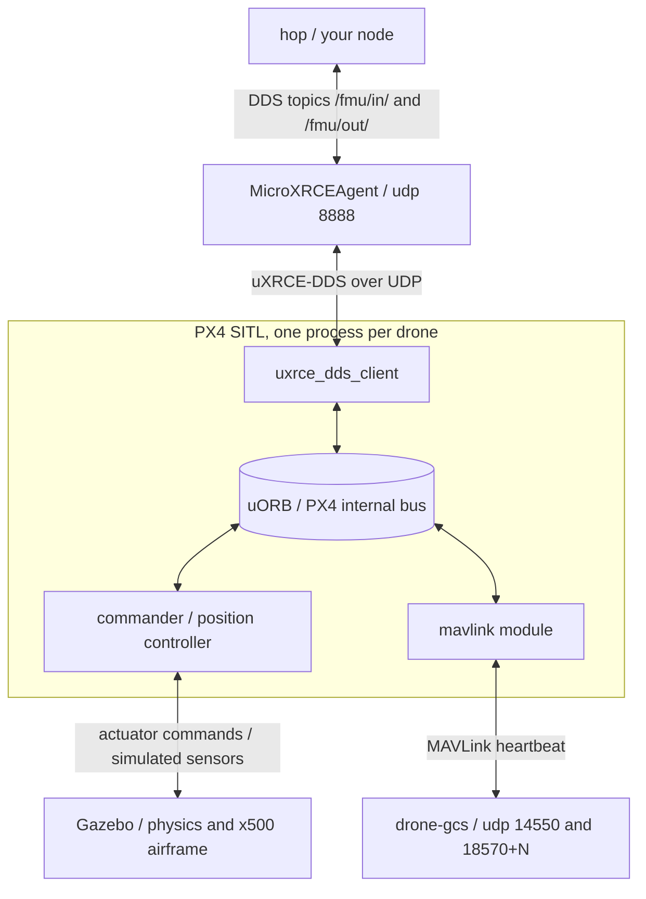

# How it works

Install: [../setup/NATIVE-SETUP.md](../setup/NATIVE-SETUP.md).

Worked example: [`../../src/cpp_single_hop/src/hop.cpp`](../../src/cpp_single_hop/src/hop.cpp). One drone, takes off, flies 3 m forward, lands. Read it alongside this document.

## Start the stack

Four terminals:

```bash
MicroXRCEAgent udp4 -p 8888     # 1. PX4 to ROS 2 bridge
drone-gcs                       # 2. ground control station link
cd ~/PX4-Autopilot              # 3. simulator, gives a pxh> prompt
PX4_SIM_MODEL=gz_x500 ./build/px4_sitl_default/bin/px4
ros2 run cpp_single_hop hop     # 4. your flight code
```

Gazebo opens a window. Terminal 4 printing nothing means the agent is not connected.

`drone-gcs` is required. PX4's x500 airframe sets `NAV_DLL_ACT 2` (return on datalink loss). It will not arm without a GCS. Without it: `Arming denied: Resolve system health failures first`. `param set NAV_DLL_ACT 0` deletes the failsafe. Run QGroundControl against udp 14550 for a real GCS. Killing `drone-gcs` mid-flight tests the failsafe.

Terminal 3 is PX4's SITL binary. PX4 also ships `make px4_sitl gz_x500`, which builds SITL if out of date and runs it. Bare `gz sim` opens Gazebo's world chooser. For swarms and long runs: `HEADLESS=1` prefix.

Expected output from `hop`:

```
[INFO] [hop]: will climb to 3.0 m, fly 3.0 m north, and land. Commanding /fmu/.
[INFO] [hop]: armed.
[INFO] [hop]: offboard engaged, climbing to 3.0 m.
[INFO] [hop]: at altitude, flying 3.0 m forward.
[INFO] [hop]: arrived, landing.
[INFO] [hop]: landed and disarmed. Flight complete.
```

Flight parameters are ROS 2 parameters:

```bash
ros2 run cpp_single_hop hop --ros-args -p altitude_m:=6.0 -p forward_m:=10.0
```

At the `pxh>` prompt:

```
pxh> commander takeoff
pxh> commander land
pxh> commander status                    # arming state, mode, failsafes
pxh> commander mode posctl
pxh> listener vehicle_local_position     # PX4's view of a uORB message
```

PX4's world is untextured. A blank grey 3D view is normal. Scroll to zoom.

To fly with scenery: [WORLDS.md](WORLDS.md).

```bash
cd ~/PX4-Autopilot
PX4_GZ_WORLD=lawn PX4_SIM_MODEL=gz_x500 ./build/px4_sitl_default/bin/px4
```

## Build and run your code

```bash
colcon build --symlink-install
source install/setup.bash
```

`--symlink-install`: editing a Python node takes effect on next `ros2 run`. Rebuild after adding files or changing `setup.py`.

Starting a package: [../development/NEW-PACKAGE.md](../development/NEW-PACKAGE.md).

`src/py_single_square` has two Python nodes:

```bash
ros2 run py_single_square listener      # position, altitude, heading, mode, 1 Hz
ros2 run py_single_square fly           # arms, goes offboard, flies a square, lands
ros2 run py_single_square fly --ros-args -p altitude:=8.0 -p side:=10.0
```

`src/cpp_single_hop` is the C++ package:

```bash
ros2 run cpp_single_hop hop         # takes off, flies 3 m forward, lands
ros2 run cpp_single_hop hop --ros-args -p altitude_m:=6.0 -p forward_m:=10.0
```

`src/swarm_naive` and `src/swarm_comms` are the multi-drone examples. Each starts its own PX4 instances:

```bash
ros2 launch swarm_naive swarm.launch.py    # 3 drones, none aware of the others
ros2 launch swarm_comms swarm.launch.py    # same flight, with inter-drone communication
ros2 launch swarm_naive swarm.launch.py --show-args
```

[../swarm/SWARM.md](../swarm/SWARM.md) covers both.

## The pipeline

Your node hands PX4 a position ten times a second. PX4 flies there.



**Your node** publishes `TrajectorySetpoint` and `OffboardControlMode`, subscribes to `VehicleLocalPosition` and `VehicleStatus`. Ordinary ROS 2 topics.

**MicroXRCEAgent** translates between DDS (ROS 2) and uXRCE-DDS (PX4). Must be running before PX4 starts.

**uxrce_dds_client** runs inside PX4, creates `/fmu/` topics. Names are `/fmu/in/...` and `/fmu/out/...`. Not renamable from the ROS side.

**uORB** is PX4's internal publish/subscribe bus. `px4_msgs` message definitions are byte-for-byte PX4's own.

**commander and position controller** are the flight stack. Commander owns arming, flight modes and failsafes. Position controller turns setpoints into attitude and thrust. Identical between SITL and a real Pixhawk.

**Gazebo** provides physics and sensors. PX4 and Gazebo run in lockstep. A slow laptop takes longer in wall-clock seconds without changing the flight. [SIMULATION-FIDELITY.md](SIMULATION-FIDELITY.md). Gazebo is the only box in the diagram not on a real aircraft. [UNDER-THE-SCRIPTS.md](UNDER-THE-SCRIPTS.md) maps the rest onto hardware.

**mavlink and drone-gcs** carry no commands from you. PX4's x500 airframe sets `NAV_DLL_ACT 2`. PX4 refuses takeoff with a failsafe whose precondition is broken. `drone-gcs` supplies the heartbeat. Killing it mid-flight fires the datalink failsafe.

## The three rules

`hop.cpp` marks each rule at the line that obeys it.

### Rule 1: QoS must match

PX4 publishes `/fmu/out/` as BEST_EFFORT with TRANSIENT_LOCAL durability. ROS 2 subscribers default to RELIABLE and VOLATILE. Incompatible: the subscription is created without error, never matches the publisher, the callback never fires.

`ros2 topic echo` negotiates QoS:

```bash
ros2 topic echo /fmu/out/vehicle_local_position   # works
```

The topic prints data from the command line while your node receives zero messages.

Use the shared profile on anything touching `/fmu/`:

```python
from py_single_square.px4_qos import PX4_QOS

self.create_subscription(
    VehicleLocalPosition, '/fmu/out/vehicle_local_position',
    self.callback, PX4_QOS)
```

Exception: `/fmu/in/vehicle_command` is served by PX4 as a RELIABLE DDS replier. Arm and mode commands require a RELIABLE publisher.

### Rule 2: offboard needs a setpoint stream before and after

PX4 will not enter offboard until already receiving setpoints. Drops out if the stream pauses for ~0.5 s. Publish `OffboardControlMode` every timer tick, before and after the mode switch. `hop.cpp` publishes on every tick of every phase, including before arming. The `Priming` phase builds one second of stream before the arm request.

### Rule 3: arming is a safety interlock

PX4 runs preflight checks and refuses to arm until they pass. `hop.cpp` reads `gcs_connection_lost`, `failsafe` and `pre_flight_checks_pass` and prints which is failing.

Satisfy PX4's checks. Never disable them. `param set NAV_DLL_ACT 0` deletes the failsafe. [SIMULATION-FIDELITY.md](SIMULATION-FIDELITY.md).

## Frames and units

**Positions are NED**: North, East, Down. Down is positive downwards. 3 m up is `z = -3`.

**The origin is the vehicle's own takeoff point**, not the world origin. With one drone this is invisible. With several, "go to north 5" means a different place for each aircraft.

**Gazebo's world frame is ENU** (East, North, Up). PX4's is NED. Spawn pose `PX4_GZ_MODEL_POSE="0,3"` is x=0 east, y=3 north, arrives at your node as `x = 3` (north). [PX4 notation page](https://docs.px4.io/v1.16/en/contribute/notation.html).

**Timestamps are microseconds** since boot. ROS time is nanoseconds. `px4_timestamp_us()` converts. PX4 ignores setpoints with wrong timestamps.

## Reading hop.cpp

| Read this | To understand |
|---|---|
| Header comment | The program and three rules |
| `Phase` enum | The flight in seven words |
| `target_position()` | The flight path: two positions |
| `run_control_tick()` | The loop: talk to PX4 first, think second |
| `advance_phase()` | When each phase ends |
| `publish_offboard_control_mode()` | Rule 2, the stream |
| `publish_setpoint()` | The "be here" message |
| `send_vehicle_command()` | Arm, mode, land, addressing |
| `run_arming()` and `describe_arming_blocker()` | Rule 3 |
| Constructor | Topics and QoS |

`std::optional` holds telemetry. Empty means PX4 has not spoken.

The drone lands ~0.4 m short of 3 m. `ARRIVAL_RADIUS_M` is 0.5 m. A multicopter holding position drifts by tens of cm.

## Changing the flight

**Move the target.** Edit `DEFAULT_ALTITUDE_M` and `DEFAULT_FORWARD_M`, or pass `-p altitude_m:=6.0`.

**Fly a path.** Replace the two positions in `target_position()` with a list and index:

```cpp
constexpr std::array<Position, 4> WAYPOINTS = {{
  {0.0, 0.0, -ALTITUDE_M},   // up
  {5.0, 0.0, -ALTITUDE_M},   // north
  {5.0, 5.0, -ALTITUDE_M},   // east
  {0.0, 0.0, -ALTITUDE_M},   // home
}};
```

`FlyingForward` becomes "advance index when `has_arrived()`, land when index runs off". [`../../src/py_single_square/py_single_square/takeoff_and_fly.py`](../../src/py_single_square/py_single_square/takeoff_and_fly.py) implements this.

**Fly a function.** Make the target a function of elapsed time: a circle is `north = R*cos(2*pi*t/T)`, `east = R*sin(2*pi*t/T)`. Feed PX4 the derivative in `TrajectorySetpoint::velocity` as feed-forward.

## More than one drone

Launch files do this. [../swarm/SWARM.md](../swarm/SWARM.md) is the guide.

```bash
MicroXRCEAgent udp4 -p 8888                       # 1
drone-gcs                                         # 2
ros2 launch swarm_naive swarm.launch.py           # 3. replaces raw PX4 command
```

Each drone is its own PX4 instance and its own copy of your node. Launch first, wait for Gazebo, then next:

```bash
cd ~/PX4-Autopilot
PX4_SYS_AUTOSTART=4001 PX4_SIM_MODEL=gz_x500 \
  ./build/px4_sitl_default/bin/px4 -i 1

PX4_SYS_AUTOSTART=4001 PX4_GZ_MODEL_POSE="0,3" PX4_SIM_MODEL=gz_x500 \
  ./build/px4_sitl_default/bin/px4 -i 2
```

`PX4_GZ_MODEL_POSE` is ENU: `"0,3"` is x=0, y=3 north. Arrives at your node as `x = 3`.

Three instance-dependent values:

| | Instance 0 | Instance N |
|---|---|---|
| Topics | bare `/fmu/...` | `/px4_N/fmu/...` |
| MAVLink system id | 1 | N + 1 |
| GCS port | 18570 | 18570 + N |

PX4 ignores commands addressed to a different system. Wrong system id: node runs, nothing arms.

```bash
ros2 run py_single_square listener --ros-args -p px4_ns:=px4_1
ros2 run py_single_square fly --ros-args -p px4_ns:=px4_2 -p sys_id:=3
ros2 run cpp_single_hop hop --ros-args -p px4_ns:=px4_2 -p system_id:=3
```

`drone-gcs` prints one line per vehicle:

```
GCS link running from /usr/local/bin/drone-gcs
Listening on udpin:0.0.0.0:14550, and heartbeating SITL instances 0-10 on ports 18570-18580.
Linked to PX4 system 2. Datalink failsafe satisfied for 1 vehicle(s); they can arm.
Linked to PX4 system 3. Datalink failsafe satisfied for 2 vehicle(s); they can arm.
```

`--expect 3` checks the count:

```bash
drone-gcs --expect 3
```

Two drones flying the same path independently form a fleet. A swarm holds a formation (shared frame, shared clock). `src/swarm_naive` flies without either. `src/swarm_comms` implements both. [../swarm/SWARM.md](../swarm/SWARM.md).

## Growing it into a swarm

The two worked packages are `src/swarm_naive` and `src/swarm_comms`. [../swarm/SWARM.md](../swarm/SWARM.md) is the guide. Problems they solve:

**Each drone is its own PX4 instance, with its own copy of your node.** Matches hardware: every airframe carries its own companion computer and sees only its own autopilot on `/fmu/`.

```bash
cd ~/PX4-Autopilot
PX4_SYS_AUTOSTART=4001 PX4_SIM_MODEL=gz_x500 \
  ./build/px4_sitl_default/bin/px4 -i 1

# wait for Gazebo, then:
PX4_SYS_AUTOSTART=4001 PX4_GZ_MODEL_POSE="0,3" PX4_SIM_MODEL=gz_x500 \
  ./build/px4_sitl_default/bin/px4 -i 2
```

Three instance-dependent things:

- **Topic namespace.** Instance 0: bare `/fmu/...`. Instance N > 0: `/px4_N` prefix. `px4_ns` parameter selects prefix.
- **MAVLink system id.** Instance N: system id N + 1. Wrong id: node runs, nothing arms.
- **Ground station link.** Each instance runs its own link on port `18570 + instance`. `drone-gcs` heartbeats every instance.

**Shared frame.** Each drone's NED origin is its own takeoff point. "North 5" means a different place per aircraft. Holding a formation requires converting one shared pattern into each drone's local frame. Two approaches:

- **Tell it.** Give each node its launch offset as a parameter. The launch config and flight code must agree. In the field, the number comes from a survey or RTK fix.
- **Arrange it.** Spawn each drone on its formation slot. Its origin is its slot. Conversion is one subtraction with no extra parameter. Welds spawn layout to pattern.

Both packages use the first. `to_local()` is the conversion. `SwarmPoint` and `LocalPoint` are separate types: wrong-frame usage is a compile error.

**Shared start.** A formation flown as a function of time holds only if every drone uses the same time. A readiness topic (`/swarm/ready`, outside `px4_` namespaces) fixes this: each drone publishes when at altitude and subscribes to count others. Nobody starts until all report. Topic is outside `px4_` because on hardware every drone publishes on bare `/fmu/`.

`swarm_comms` implements this on `/swarm/state`. Topic is BEST_EFFORT. Readiness repeats 10 Hz; a lost message costs nothing. Depth must be at least the number of drones.

**What changes on real aircraft:**

- **Network.** One machine here. Real drones: WiFi, real latency, loss, partitions. Test separately.
- **One agent per drone.** `MicroXRCEAgent` runs on each companion computer.
- **Position accuracy.** Plain GPS: metres. RTK: centimetres. Sets tightest formation.
- **Recovery.** Simulation: bad setpoint costs a restart.

## Problems

Run `./scripts/smoke-test.sh` first.

| Symptom | Cause | Fix |
|---|---|---|
| `Arming denied: Resolve system health failures first` | No GCS link | Run `drone-gcs`. Not `NAV_DLL_ACT 0` |
| Gazebo shows demo worlds, no drone | Ran `gz sim` | `PX4_SIM_MODEL=gz_x500 ./build/px4_sitl_default/bin/px4` |
| `Waiting for Gazebo world...` then timeout | World name doesn't match file name | [WORLDS.md](WORLDS.md) |
| No `/fmu/` topics | Agent not running or started after PX4 | Start agent, restart PX4 |
| Callback never fires, `ros2 topic echo` shows data | QoS mismatch | `PX4_QOS` |
| `Standalone PX4 launch, waiting for Gazebo` | `PX4_GZ_STANDALONE` set | `unset PX4_GZ_STANDALONE` |
| Gazebo at 2 fps | Software rendering | Smoke test section 6 |
| Offboard rejected | Setpoint stream not running | Publish setpoints before mode change |
| Arms then disarms | Failsafe tripped | `pxh> commander status` |
| `ros2 run py_single_square` not found | Overlay not sourced | `source install/setup.bash` |
| Node runs, never arms | Wrong `system_id` | Instance N needs system id N + 1 |
| First drone flies, rest never arm | `drone-gcs` serving one vehicle | Should print one linked system per drone |
| New drones spawn into field with existing drones | Gazebo server survived last run | `pkill -f 'gz sim'` |

## Reference

PX4 v1.16.1 pinned. Check behavior against it, not a search result.

**PX4 and ROS 2**
- [ROS 2 User Guide](https://docs.px4.io/v1.16/en/ros2/user_guide)
- [Offboard Control example](https://docs.px4.io/v1.16/en/ros2/offboard_control)
- [Offboard mode reference](https://docs.px4.io/v1.16/en/flight_modes_mc/offboard.html)
- [uXRCE-DDS bridge](https://docs.px4.io/v1.16/en/middleware/uxrce_dds)
- [px4_msgs, release/1.16](https://github.com/PX4/px4_msgs/tree/release/1.16/msg)
- [Multi-vehicle with ROS 2](https://docs.px4.io/v1.16/en/ros2/multi_vehicle)
- [Multi-vehicle in Gazebo](https://docs.px4.io/v1.16/en/sim_gazebo_gz/multi_vehicle_simulation.html)
- [Gazebo simulation](https://docs.px4.io/v1.16/en/sim_gazebo_gz/)
- [Safety and failsafe configuration](https://docs.px4.io/v1.16/en/config/safety.html)
- [Parameter reference](https://docs.px4.io/v1.16/en/advanced_config/parameter_reference.html)
- [Frame and notation conventions](https://docs.px4.io/v1.16/en/contribute/notation.html)
- [MAVLink common messages](https://mavlink.io/en/messages/common.html)

**ROS 2 Jazzy**
- [Understanding topics](https://docs.ros.org/en/jazzy/Tutorials/Beginner-CLI-Tools/Understanding-ROS2-Topics/Understanding-ROS2-Topics.html)
- [Quality of Service](https://docs.ros.org/en/jazzy/Concepts/Intermediate/About-Quality-of-Service-Settings.html)
- [Writing a C++ publisher and subscriber](https://docs.ros.org/en/jazzy/Tutorials/Beginner-Client-Libraries/Writing-A-Simple-Cpp-Publisher-And-Subscriber.html)
- [Creating a package](https://docs.ros.org/en/jazzy/Tutorials/Beginner-Client-Libraries/Creating-Your-First-ROS2-Package.html)
- [Launch files](https://docs.ros.org/en/jazzy/Tutorials/Intermediate/Launch/Creating-Launch-Files.html)
- [Custom messages](https://docs.ros.org/en/jazzy/Tutorials/Beginner-Client-Libraries/Custom-ROS2-Interfaces.html)

**This repo**
- [../swarm/SWARM.md](../swarm/SWARM.md)
- [UNDER-THE-SCRIPTS.md](UNDER-THE-SCRIPTS.md)
- [SIMULATION-FIDELITY.md](SIMULATION-FIDELITY.md)
- [WORLDS.md](WORLDS.md)
- [../development/NEW-PACKAGE.md](../development/NEW-PACKAGE.md)
- [../setup/NATIVE-SETUP.md](../setup/NATIVE-SETUP.md)